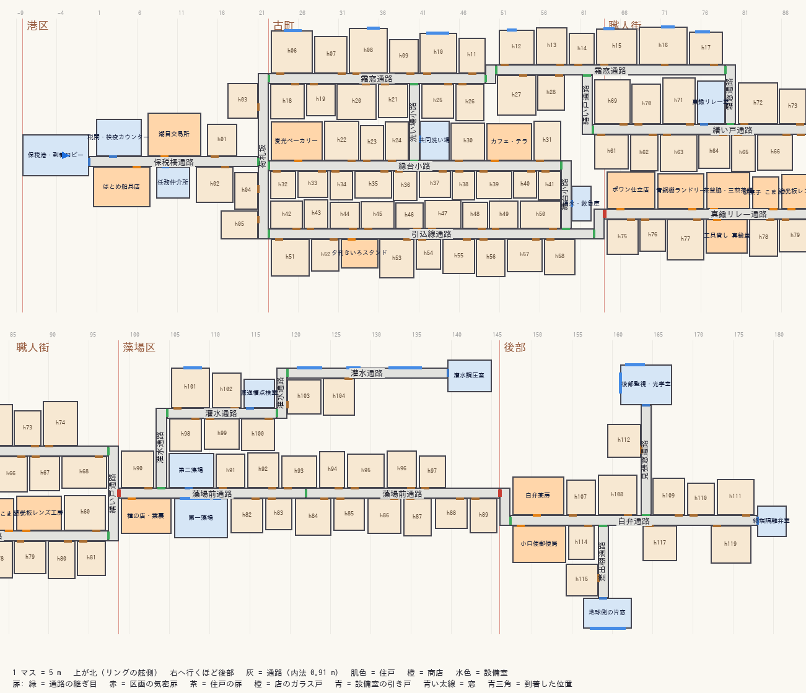

# ヘイヴン・リング 改装設計図

地球軌道上の回転居住港「ヘイヴン・リング」の内装と外装です。内装のコードは `src/world/haven/`（`plan.js` = 通路・ロビー・設備室、`homes.js` = 住戸、`shops.js` = 商店、`interior.js` = 組み立て）、外装は `haven/exterior.js` と `src/world/stations.js` の `haven()`、平面図は [haven-plan.png](haven-plan.png) です。

## 決めごと

| 項目 | 決めたこと | できあがり |
|---|---|---|
| 外装の大きさ | 500 m 級 | リング半径 222 m、太陽電池の翼まで含めて幅 510 m × 高さ 507 m |
| 内装の大きさ | 200 m 級 | 居住デッキ 190 m × 35 m（床面積 3,160 m²） |
| 通路の幅 | プレイヤーの幅 1.3 人分 | 内法 0.91 m（壁 0.2 m を両側に足して 1.31 m）。扉の幅も同じ |
| 通路 | 10 本以上 | 13 本、合計 448 m |
| 家 | 90 件以上 | 112 軒（9.9〜28.2 m²、中央値 16.6 m²） |
| 商業施設 | 10 件以上 | 14 軒 |
| 広い空間 | 作らない | いちばん広い部屋は到着ロビーの 42.6 m²。広場・ホールは無し |
| 天井 | 高くしない | 2.18〜2.55 m |
| 明るさ | 暗くしない | 白・生成り・淡色の壁を中心に、灯りは 1 本ずつ位置を決めた（通路 3〜4 m おき）。外の舷側に面した家と通路には窓 |
| 素材 | ヘイヴン用の素材を使う | `assets/haven/sheet-00〜49` の 450 枚すべてを、壁・床・天井・家具の面・壁の絵・床の継ぎ当てのどこかで使っている |
| 作り方 | パターン化・機械化しない | 部屋・扉・灯り・備品の座標はすべて手で書いた数字。繰り返しで並べる処理（ループで家を並べる、乱数で配置する）は使っていない |

## 構造のしくみ

- **リングの一部としてのデッキ**: x がリングの回転方向（港 → 後部）、z がリングの幅方向。北（−z）はリングの舷側で、北の端の家と灌水通路の外窓からは宇宙が見える。
- **5 つの気密区画**: 港区 / 古町 / 職人街 / 藻場区 / 後部。区画の境（隔壁）を通路が横切る所だけ気密扉（赤）にしてあり、ほかの通路どうしのつなぎ目は枠の無い継ぎ目。外装でも同じ角度に隔壁の帯が巻いてある。
- **通路は配管に沿う**: 通路の天井際には区画ごとに違う色・太さ・高さの配管が走る（引込線は貨物の配管、灌水通路は給水管 2 本、真鍮リレー通路は真鍮の電力管）。
- **到着の流れ**: ハブからスポーク A の昇降機で降りると到着ロビー。東の引き戸から保税柵通路 → 荷札坂で北・中・南の 3 本の道に分かれる。
- **環になった道**: 古町は霜窓通路・洗い場小路・縁台小路・引込線通路で輪になり、職人街は繕い戸通路と真鍮リレー通路で輪になる。藻場区と後部は枝分かれした行き止まりの道で、奥に設備室がある。

## 通路 13 本

| 通路 | 長さ | 天井 | 灯り | 特徴 |
|---|---|---|---|---|
| 保税柵通路 | 21.0 m | 2.36 | 蛍光灯・暖色 | 到着ロビーから最初の通路。黄色い縞の床、税関・交易所・船具店・任務仲介所の入口が並ぶ |
| 荷札坂 | 20.6 m | 2.42 | 埋め込み灯 | 南北に延びる港区と古町の境。3 本の道の分かれ目。縞鋼板の床 |
| 霜窓通路 | 65.1 m | 2.28〜2.32 | 青白い蛍光灯 | 古町の北の通路。白い壁と紺の格子床。途中で柱をよけて 1 m 北へずれ、東の端で南へ下る |
| 引込線通路 | 44.1 m | 2.26〜2.38 | 蛍光灯・黄色 | 古町の南の通路。黄色いルーバーの床、天井際に貨物の配管 2 本。東の端で隔壁を抜けて職人街へ |
| 洗い場小路 | 9.5 m | 2.26 | 埋め込み灯・水色 | 霜窓通路と縁台小路を南北につなぐ短い小路。タイルの壁、共同洗い場の入口 |
| 縁台小路 | 44.7 m | 2.28〜2.30 | 天井パネル | 古町の真ん中。両側に小さな長屋が 20 軒並ぶ。東の端で南へ折れて引込線通路へ |
| 真鍮リレー通路 | 33.4 m | 2.40 | 蛍光灯・琥珀 | 職人街の大通り。オレンジの格子床、真鍮の電力管。北に仕立店・ランドリー・茶舗・駄菓子屋・レンズ工房 |
| 繕い戸通路 | 54.1 m | 2.30〜2.36 | 蛍光灯 | 職人街の北の通路。霜窓通路から上り口で下りてきて、東の曲がり角で真鍮リレー通路とつながる |
| 灌水通路 | 49.8 m | 2.24〜2.32 | 緑がかった灯り | 藻場区の北へ 3 回折れる。最後の 20 m は外の舷側に沿い、窓が 3 か所。突き当たりに灌水調圧室 |
| 藻場前通路 | 47.3 m | 2.36〜2.40 | 蛍光灯・天井パネル | 藻場区の南北の家の間。第一藻場を窓越しに見られる |
| 白弁通路 | 35.4 m | 2.28〜2.34 | 白い蛍光灯 | 後部の通路。白い壁、薬房と郵便局。突き当たりに終端隔離弁室 |
| 見張窓通路 | 13.7 m | 2.30 | 埋め込み灯・青白 | 白弁通路から北へ。突き当たりの後部監視・光学室には窓が 2 面 |
| 差出棚通路 | 8.9 m | 2.26 | 天井パネル | 白弁通路から南へ。郵便の差出棚の壁、突き当たりに地球側の片窓 |

## 商店 14 軒

| 店 | 通路 | 大きさ (m) | できること |
|---|---|---|---|
| 潮目交易所 | 保税柵通路 | 6.6 × 5.4 | 交易市場、仲買人と話す |
| はとめ船具店 | 保税柵通路 | 7.1 × 5.0 | 機体の整備と換装 |
| 麦光ベーカリー | 縁台小路 | 6.4 × 4.8 | 取り置きのパン（会話） |
| カフェ・テラ | 縁台小路 | 5.6 × 4.6 | カフェで一息 |
| 夕刊きいろスタンド | 引込線通路 | 4.6 × 3.6 | 夕刊の見出し（会話） |
| ポワン仕立店 | 真鍮リレー通路 | 6.0 × 4.6 | 端切れの持ち込み（会話） |
| 青銅棚ランドリー | 真鍮リレー通路 | 5.8 × 4.4 | 洗濯機の運転時刻（会話） |
| 茶釜脇・三煎茶舗 | 真鍮リレー通路 | 5.4 × 4.5 | 本日の茶葉（会話） |
| 駄菓子 こまどり | 真鍮リレー通路 | 3.3 × 4.0 | こまどりの奥さん（会話） |
| 遮光板レンズ工房 | 真鍮リレー通路 | 5.6 × 4.3 | ピントの修理（会話） |
| 工具貸し 真鍮堂 | 真鍮リレー通路 | 5.2 × 4.2 | 真鍮堂の主人（会話） |
| 種の店・葉裏 | 藻場前通路 | 6.2 × 4.4 | 種子と水耕の相談（会話） |
| 白弁薬房 | 白弁通路 | 6.4 × 4.8 | 診療ポッドで治療 |
| 小口便郵便局 | 白弁通路 | 6.6 × 4.6 | 地球行きの集荷（会話） |

## 設備室 13 室

到着ロビー（自機へ戻る・星図・任務端末）、税関・検疫カウンター、任務仲介所（任務の掲示板）、共同洗い場、消火・救急庫、真鍮リレー室、第一藻場（水耕棚、通路から窓越しに見える）、第二藻場（苗床）、濾過槽点検室、灌水調圧室、後部監視・光学室（窓 2 面と望遠鏡）、地球側の片窓（星図）、終端隔離弁室。

## 住戸 112 軒

どの家も、通路のどちら側にあるか・間口・奥行き・天井・扉の位置・壁 / 床 / 天井の素材・灯りの色・家具の並びを 1 軒ずつ決めてある。間口 2.8 m の一間から 6 m の三世代の家まで大きさもばらばら。

| 区画 | 通路 | 家 |
|---|---|---|
| 港区 | 保税柵通路・荷札坂 | h01 港湾当直の仮眠室、h02 荷役主任の家、h03 計量士の家、h04 白い湯沸かしの部屋、h05 錨綱の家 |
| 古町・北 | 霜窓通路の北（舷側、窓あり 7 軒） | h06 霜取り係の家、h07 双子の寝台部屋、h08 ラジオ修理の家、h09 祖母の漬物部屋、h10 舷窓画家のアトリエ、h11 夜勤看護師の部屋、h12 温室帰りの姉妹、h13 配管工ロウの家、h14 本の多い独り部屋、h15 楽器職人の家、h16 三世代の家、h17 天文少年の家 |
| 古町・中 | 霜窓通路の南・縁台小路の北 | h18 網戸の家、h19 パン職人の下宿、h20 鉢植えだらけの家、h21 元整備士の家、h22 洗濯物の多い家、h23 暗算の得意な少女の家、h24 時計直しの家、h25 水耕の兄弟、h26 料理番トマの家、h27 船外作業員の家、h28 黄色いカーテンの家、h30 床屋の奥さんの家、h31 坂の上の老夫婦 |
| 古町・長屋 | 縁台小路の南・引込線通路の北 | h32 行商人の一間、h33 洗い張りの家、h34 鳥籠の部屋、h35 卓球台のある家、h36 若い配電工の部屋、h37 刺繍の家、h38 詩人の一間、h39 水槽番の家、h40 双眼鏡の家、h41 乾物屋の隠居、h42 夜明け前の家、h43 紙飛行機の部屋、h44 三毛猫の家、h45 ガラス吹きの家、h46 計算尺の家、h47 双子の母の家、h48 蝋燭作りの部屋、h49 静かな家、h50 豆を挽く家 |
| 古町・南 | 引込線通路の南 | h51 船大工の家、h52 月刊誌の編集部屋、h53 双発機の模型の家、h54 花屋の娘の部屋、h55 天井の低い家（2.18 m）、h56 太鼓の家、h57 錆止め塗りの家、h58 歯医者の住まい |
| 職人街 | 繕い戸通路・真鍮リレー通路 | h60 旋盤工の家、h61 仕立屋の住み込み、h62 洗濯物たたみの家、h63 陶工の家、h64 古い茶器の家、h65 ボタン職人の家、h66 研磨師の家、h67 ちいさな印刷所の家、h68 時刻表を集める家、h69 繕い物の家、h70 鉄琴の家、h71 靴直しの家、h72 温室番の家、h73 電信の家、h74 双子座の家、h75 蒸留水の家、h76 宝石磨きの家、h77 ガラス戸の家、h78 眼鏡の家、h79 子守唄の家、h80 紙の家、h81 流しの床屋の家 |
| 藻場区 | 藻場前通路・灌水通路 | h82 藻の研究者の家、h83 夜の水やり番、h84 緑の壁の家、h85 受粉係の家、h86 水槽のある家、h87 土の匂いの家、h88 菜園係の老人、h89 苔玉の家、h90 温室管理人の家、h91 雨音を録る家、h92 葉っぱ茶の家、h93 小さな双子の家、h94 計量カップの家、h95 天窓のない画家、h96 夜明けの体操の家、h97 縫いぐるみの家、h98 配水図を描く家、h99 古いポンプの家、h100 霧吹きの家、h101 星見台の家（窓あり）、h102 双葉の家、h103 梯子職人の家、h104 機械油の家 |
| 後部 | 白弁通路・見張窓通路・差出棚通路 | h107 薬剤師の家、h108 静養中の船長、h109 望遠鏡の家、h110 郵便配達人の家、h111 最後の家、h112 夜間当直の家、h114 切手収集家、h115 手紙を代筆する家、h117 歌う溶接工、h119 終端弁の番人 |

（番号の抜けは、設計の途中で通路や設備室に場所を譲った区画）

## 外装

- **リング**: 半径 222 m。全周に太さ 4.2 m の保守用の背骨を通し、その上に太さの違う気密殻を 10 区画かぶせた（居住デッキの 5 区画は 15〜18 m、放熱・貨物・建設中・農業・設備の区画は 10〜14 m）。区画の間は背骨だけが見える。
- **窓の帯**: 居住デッキの 5 区画、農業区画（緑）、建設中の区画の手前（暖色）に、両側の舷側の窓の明かり。
- **隔壁の帯**: 区画の境 15 か所に、それぞれ違う太さの帯。建設中の区画（4.12〜4.58 rad）は外板を張らず、輪の骨組みと足場だけ。
- **外に吊った設備**: 放熱区画の放熱箱 3 基、貨物区画のコンテナ 3 基、設備区画の機械箱 1 基。
- **スポーク 3 本（回る）**: A = 昇降機の角柱（到着ロビーへ降りる）、B = 2 本の管のトラス、C = 窓のある与圧筒。ハブの軸受けリングにつながる。
- **ハブ（回らない）**: 胴（半径 30 m）、前の接舷筒（接舷口は z = 52 m）、後ろの機械区画、マスト、太陽電池の翼 4 枚（幅 214 m）、放熱板 2 枚、アンテナ。正面に「HAVEN RING」「地球軌道港 A01」の看板。
- **回転**: 毎秒 0.199 rad（約 32 秒で 1 周）。半径 222 m の外周で約 0.9 G（地球側の片窓の表示と同じ）。当たり判定（`havenHullDistance`）はリングの回転角も使う。

## 確かめたこと

- 部屋どうしの重なりなし。167 か所の扉すべてが、隣り合う 2 部屋の共有する壁の範囲に収まっている。
- 壁に貼った看板・絵・パネルが扉の開口にかかっていない。窓は外に面した壁だけ（第一藻場と藻場前通路の間の内窓を除く）。
- 到着した位置から 0.1 m 刻みでたどって、164 部屋すべてに入れ、131 か所の「調べる」すべてに手が届く。
- 読み込み時のエラー・警告なし。
