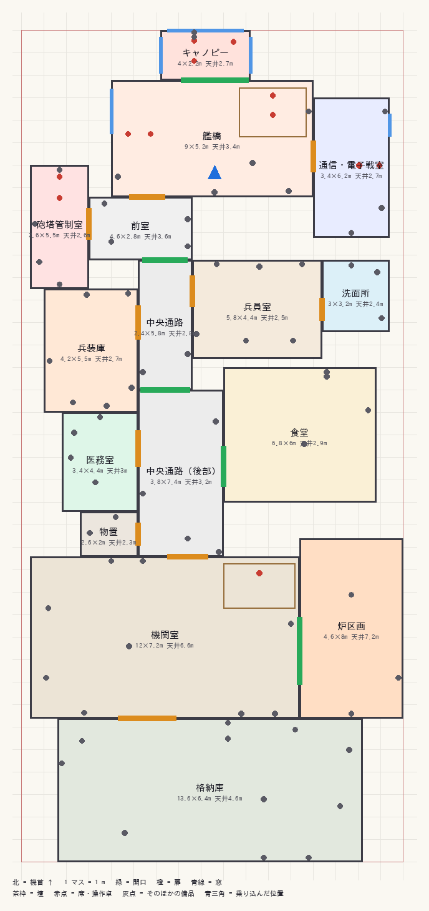

# ライデン 船内 設計図

重装ガンシップ「ライデン」の船内です。コードは `src/world/blueprints.js` の `raiden()`、平面図は [raiden-plan.png](raiden-plan.png) です。



## 決めごと

- **広さは改修前と同じ**: 船内は x −4〜13 m、z 0〜37 m の範囲（北が機首）に収める。床面積は約 470 m²（改修前は約 450 m²）。
- **部屋は 1 つずつ手で置く**: 左右対称・同じ大きさの部屋の繰り返し・等間隔の扉は使わない。部屋ごとに、その部屋の仕事から大きさ・天井の高さ・扉の位置を決める。
- **改修前の働きは全部残す**: 操縦席に座る、星図、弾薬補給、寝台で休む、船体状況、エアロックから出る。医療ポッド（治療）と自販機を足した。
- **素材**: `rd-` で始まる 54 枚（シート 94〜99）を使う。画像が届くまでは、`RM()` で既存の素材に色を付けて代わりにする。

## 動線

乗り込むと艦橋の後ろ寄り（青三角）に立つ。前を向くと、一段低い開口の先に機首のキャノピーがある。

```
キャノピー ─(開口)─ 艦橋 ─(東の扉)─ 通信・電子戦室
                     │
                    (南西の扉)
                     │
砲塔管制室 ─(扉)─ 前室 (梯子で背面の砲塔へ)
                     │(開口)
兵装庫 ─(扉)─ 中央通路 ─(扉)─ 兵員室 ─(扉)─ 洗面所
                     │(開口: ここで東へ広がる)
医務室 ─(扉)─ 中央通路 (後部) ─(大きな開口)─ 食堂
物置 ──(扉)─┘       │(隔壁扉)
                  機関室 ─(大きな開口)─ 炉区画
                     │(隔壁扉、左寄り)
                  格納庫 ─ 後部ランプ (右寄り) から外へ
```

## 部屋ごとの設計

| 部屋 | 大きさ (m) | 天井 | ねらい | 主な備品 |
|---|---|---|---|---|
| キャノピー | 4 × 2.2 | 2.7 | 機首の先端。三方が窓。操縦士は中心線より左に座り、右に副操縦の小卓を置いて、正面から見て左右非対称にした | 操縦席（操縦席に座る）、操縦卓、副操縦卓、ヘッドアップディスプレイ |
| 艦橋 | 9 × 5.2 | 3.4 | キャノピーより一段奥の指揮所。右舷に兵装士官の壇（0.4 m 高い、西側に階段）、左舷の窓際に航法席、後ろ寄りの右に戦術台。艦橋の扉は東（通信室）と南西（前室）で、中心線上に扉を置かない | 兵装士官席と兵装卓、航法卓、戦術台、星図、ロッカー |
| 通信・電子戦室 | 3.4 × 6.2 | 2.7 | 艦橋の東の扉からだけ入れる細長い部屋。東の壁に機器を寄せ、小さな丸窓を 1 つ | 通信卓、ラック、照準画面 |
| 前室 | 4.6 × 2.8 | 3.6 | 艦橋と通路の間の小さなたまり。天井を高くして、背面の砲塔へ上る梯子を立てる | 梯子、待機表、宇宙服ロッカー、床の点検口 |
| 砲塔管制室 | 2.6 × 5.5 | 2.6 | 前室の西に張り出した細長い部屋。奥に照準器、壁際に弾の送り込み装置 | 照準卓と席、砲弾の送り込み装置、砲塔の操作盤 |
| 中央通路 | 2.4 × 5.8 | 2.8 | 幅 2.4 m の狭い通路。扉は兵装庫（西）と兵員室（東）で、位置をずらしてある | 配管の壁、救急箱 |
| 兵装庫 | 4.2 × 5.5 | 2.7 | 北と西の壁に銃架。入口から見て奥（南）に弾薬箱と防弾服のロッカー | 銃架 2 つ、弾薬補給、弾薬箱、防弾服ロッカー |
| 兵員室 | 5.8 × 4.4 | 2.5 | 天井の低い寝室。二段ベッドは南の壁に沿って横向きに 2 台。東の奥に洗面所 | 二段ベッド（寝台で休む）、個人ロッカー、部隊章のボード、写真、「雷電」の札 |
| 洗面所 | 3 × 3.2 | 2.4 | 兵員室の奥の角に押し込んだ狭い部屋 | 洗面台、シャワー（カーテン付き）、トイレ |
| 中央通路（後部） | 3.8 × 7.4 | 3.2 | 前の通路から東へ 1.4 m 広がる。広がった所にベンチを置き、ひと息つける場所にした | ベンチ、電力ケーブルの壁、床の標示 |
| 医務室 | 3.4 × 4.4 | 3.0 | 通路の西。白い壁 | 医療ポッド（治療）、診察用スキャナー、救急箱、薬品タンク |
| 食堂 | 6.8 × 6 | 2.9 | 通路から大きく開いた部屋。北の壁に厨房、真ん中に金属の長机 | 厨房、長机、自販機 |
| 物置 | 2.6 × 2 | 2.3 | 通路の南西の角の小部屋 | 予備の箱、非常用ロッカー |
| 機関室 | 12 × 7.2 | 6.6 | 左舷に大小 2 基のタービン、北東の角に計器の壇（0.9 m）。東は炉区画へ 3 m 開いている | タービン 2 基、計器の壇と制御卓、船体状況、配管と排熱口 |
| 炉区画 | 4.6 × 8 | 7.2 | 機関室の右舷に張り出した、いちばん天井の高い区画。南の壁に炉心の覗き窓 | 炉、炉心の覗き窓 |
| 格納庫 | 13.6 × 6.4 | 4.6 | 機関室からの入口は左寄り、外へ出るランプは右寄り。南の壁沿いにコンテナ | コンテナ、固定された木箱、燃料電池、工具カート、出口（後部ランプ） |

## 扉

| つなぐ部屋 | 位置 | 幅 × 高さ (m) | 種類 |
|---|---|---|---|
| キャノピー ↔ 艦橋 | x 4.6 | 3.0 × 2.4 | 開口 |
| 艦橋 ↔ 通信・電子戦室 | z 5.6 | 1.4 × 2.2 | 引き戸 |
| 艦橋 ↔ 前室 | x 1.6 | 1.6 × 2.3 | ハッチ |
| 前室 ↔ 砲塔管制室 | z 8.6 | 1.4 × 2.2 | ハッチ |
| 前室 ↔ 中央通路 | x 2.4 | 2.0 × 2.4 | 開口 |
| 中央通路 ↔ 兵装庫 | z 13.0 | 1.5 × 2.2 | ハッチ |
| 中央通路 ↔ 兵員室 | z 11.6 | 1.4 × 2.2 | 引き戸 |
| 兵員室 ↔ 洗面所 | z 12.4 | 1.0 × 2.1 | 引き戸 |
| 中央通路 ↔ 中央通路（後部） | x 2.4 | 2.2 × 2.6 | 開口 |
| 中央通路（後部） ↔ 医務室 | z 18.6 | 1.6 × 2.2 | 引き戸 |
| 中央通路（後部） ↔ 食堂 | z 19.4 | 1.8 × 2.4 | 開口 |
| 中央通路（後部） ↔ 物置 | z 22.4 | 1.0 × 2.0 | ハッチ |
| 中央通路（後部） ↔ 機関室 | x 3.4 | 1.8 × 2.3 | 隔壁扉 |
| 機関室 ↔ 炉区画 | z 27.6 | 3.0 × 3.2 | 開口 |
| 機関室 ↔ 格納庫 | x 1.6 | 2.6 × 2.5 | 隔壁扉 |

## 素材（シート 94〜99、`rd-` 54 枚）

画像がまだ無い素材は、部屋の壁・床・天井は `RM(名前, 代わりの素材, 色)` で既存の素材を使い、絵を貼る備品（`picwall` / `picfurn` / `pictop` / `floorpic` / `band`）は画像が無ければ貼らない。

| シート | 素材 | 使う所 |
|---|---|---|
| 94 艦橋とキャノピー | rd-bridge-floor / rd-bridge-wall / rd-ceiling-bridge / rd-canopy-frame / rd-pilot-console / rd-gunner-console / rd-tactical-table / rd-warning-panel / rd-hud-glass | キャノピーと艦橋の床・壁・天井、操縦卓、兵装卓、戦術台の天板、警告灯、ヘッドアップディスプレイ |
| 95 通路と前室 | rd-corridor-wall / rd-corridor-floor / rd-corridor-ceil / rd-hatch-floor / rd-pipe-wall / rd-ready-board / rd-emergency-locker / rd-deck-marking / rd-bulkhead-door | 通路の壁・床・天井（船内の標準）、床の点検口、配管の壁、待機表、非常用ロッカー、床の標示、隔壁扉 |
| 96 兵装 | rd-armory-wall / rd-rifle-rack / rd-ammo-crates / rd-gun-sight / rd-turret-controls / rd-shell-feed / rd-armor-locker / rd-target-screen / rd-gunnery-floor | 兵装庫と砲塔管制室の壁・床、銃架、弾薬箱、照準器、操作盤、砲弾の送り込み装置、防弾服ロッカー、照準画面 |
| 97 乗員区画 | rd-crew-wall / rd-bunk-blanket / rd-crew-locker / rd-galley / rd-mess-table / rd-medbay-wall / rd-med-scanner / rd-crew-photo / rd-patch-board | 兵員室と食堂の壁、毛布、個人ロッカー、厨房、長机の天板、医務室の壁、スキャナー、写真、部隊章 |
| 98 機関 | rd-engine-floor / rd-engine-wall / rd-reactor-core / rd-turbine / rd-coolant-panel / rd-power-conduit / rd-heat-vent / rd-catwalk-grate / rd-engine-gauges | 機関室の床・壁、炉心の覗き窓、タービン、冷却盤、電力ケーブル、排熱口、炉区画の床、計器 |
| 99 格納庫 | rd-cargo-floor / rd-cargo-wall / rd-ramp-door / rd-cargo-net / rd-strap-crates / rd-loader-arm / rd-fuel-cells / rd-tie-down / rd-airlock-panel | 格納庫の床・壁、後部ランプの扉、荷物ネット、固定された木箱、荷役アーム、燃料電池、床の固定具、エアロックの操作盤 |

## 確かめたこと

- 15 か所すべての扉を、プレイヤーが通り抜けられる（扉の前後 0.9 m を歩ける）。
- 乗り込んだ位置から 0.15 m 刻みでたどって、16 部屋すべてに入れ、8 つの「調べる」すべてに手が届く。
